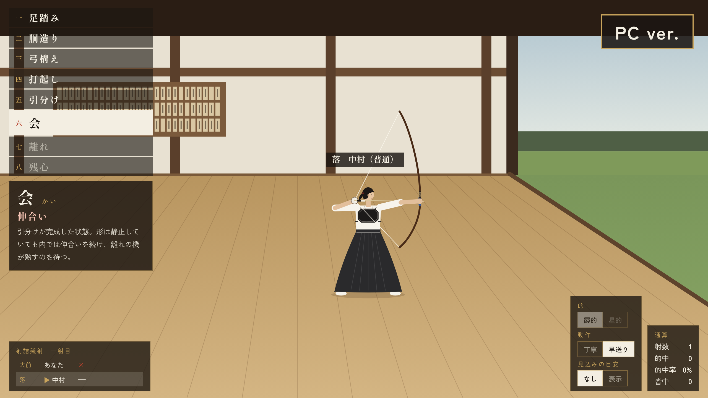
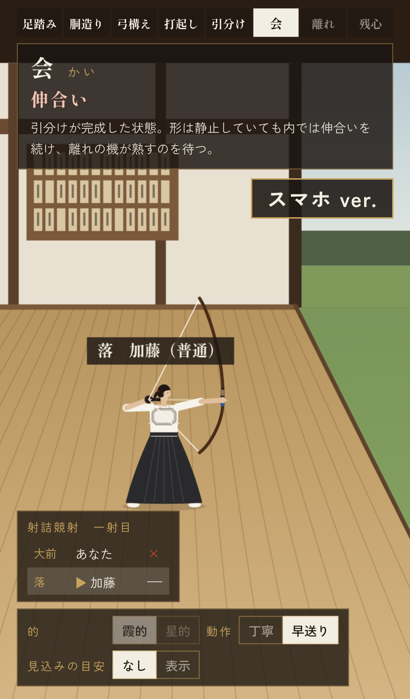
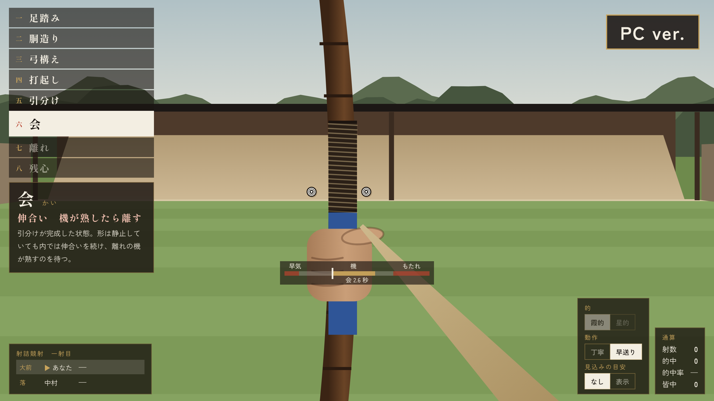
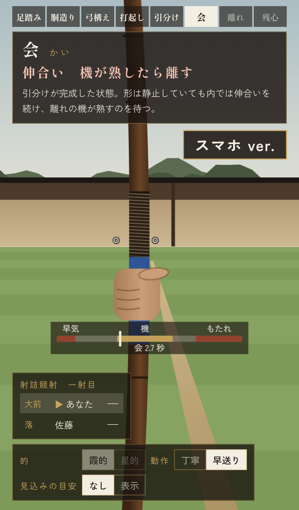

# 一射入魂 ― 一射ずつ丁寧に

射法八節をひとつずつたどり、28m先の的を実寸で狙う、ブラウザで遊べる弓道ゲームです。
弓道を知らない人が「弓道っておもしろそう」と思うきっかけになることを目指して作りました。

**▶ 遊ぶ：https://tamago-boro-156.github.io/kyudo/**

PC・スマホのどちらでも遊べます。インストールは不要です。

| PC | スマホ |
|---|---|
|  |  |
|  |  |

## 遊び方

1. 足踏み・胴造り・弓構えは、射手が順に整えていきます。画面左の射法八節で、いまの動作とその意味を確かめられます。
2. 弓構えが整ったら、画面を押し続けて打起し、大三へ進みます（横からの視点）。
3. 引分けに入ると、射手の目線に切り替わります。的は実寸どおりに小さく見えます。
4. 会では、弓の右の縁が的の中央にかかる「半月」の見込みを目指します。押したままドラッグ（または矢印キー）で狙いを直します。
5. 指を離すと離れです。会が短すぎると早気、長すぎるともたれで狙いが乱れます。揺れが収まる「機」を待って離します。

## 種目

- **稽古**：一立ち四射。四本すべて中れば皆中です。
- **射詰競射**：一人一本ずつ射て、外した者から抜けていきます。四射目からは八寸的（直径24cm）に掛け替え、中りは◎で記録します。同じ回に抜けた人の順位は遠近競射で決めます。
- **遠近競射**：全員が一つの的を射て、中心に近い順に順位が決まります。
- **オンライン対戦**：同じ合言葉を入れた人どうしが一つの部屋に集まり（最大5人）、射詰競射か遠近競射で対戦します。主催が種目と的を選び、射順の発表や各射の結果のあとも主催の操作で全員の画面が進みます。相手の番には、その人の一射が横からの視点で再生されます。

競技では、AIの相手を1〜4人、強さを「易しい・普通・強い・鬼」から選べます。射順はくじで決まります。

## こだわった点

- **実寸の見え方**：画面の長辺を画角50°とした透視投影で、28m先の直径36cmの的（見かけ約0.74°）、弓の幅、拳の大きさまで同じ縮尺で描いています。
- **的の規格**：霞的は弓道競技規則（第26条）の寸法どおりです。中白は半径3.6cm、一の黒3.6、二の白3.0、二の黒1.5、三の白3.0、三の黒3.3cmです。星的は直径12cmの星です。的の中心は安土敷から27cmの高さにあります。
- **射法八節**：全日本弓道連盟『弓道教本 第一巻 射法篇』の要旨に沿った説明を、動作に合わせて表示します。大三では弓手と馬手を同じ高さに保ち、会では馬手を「∠」の形にしています。
- **道具と装い**：弓の握り革と矢摺籐、甲矢・乙矢で向きが逆になる矢羽、八角胸当て、袴の形を描き分けています。道着・弽・矢羽・胸当ての色は、射手ごとにランダムで決まります。
- **二つの視点**：打起しから大三までは横から、引分けからは射手の目線で描いています。離れのあとは的に寄って、中った輪の名前と中心からの距離（cm）を表示します。

## 技術

- HTML / CSS / JavaScript だけで書いた、1ファイル（`index.html`）のゲームです。外部ライブラリは使っていません（オンライン対戦のときだけ Firebase を読み込みます）。
- 描画には Canvas 2D を使っています。射手の姿勢は関節の座標を持つポーズとして定義し、ポーズの間を補間してアニメーションさせています。
- 弦音と的中音は、音声ファイルを使わずに Web Audio API で合成しています。
- 進行は状態遷移（足踏み → … → 会 → 離れ → 残心）で管理し、競技モードの射順・脱落・順位決定もその上に組んでいます。
- AIの矢所は二次元の正規分布で決めています。強さごとに標準偏差を変え、中る確率は易しい約4割、普通約7割、強い約9割です。
- 成績と設定はブラウザの localStorage に保存します。
- オンライン対戦は Firebase の Realtime Database と匿名認証を使っています。部屋には在室者・射順・一本ごとの矢所だけを置き、勝敗は各端末が同じ記録から同じ手順で計算します。主催の端末に頼らないので、途中で誰かが抜けても対戦は続きます。

## 制作について

このゲームは、AIアシスタントの Claude（Anthropic）と対話しながら作りました。

- **自分が担当したこと**：企画（弓道に興味を持ってもらうという狙い）、ゲームの仕様、弓道の所作・道具の監修、見た目と遊びやすさの判断、実際に遊んでの確認とフィードバック
  - 例：大三で弓手と馬手を同じ高さにそろえる、会の馬手を「∠」の形にする、足踏みで物見をする、袴を分かれない形にする、握り革の上に矢摺籐を入れる、八寸的での中りを◎で記録する、射詰で同じ回に抜けた人の順位を遠近競射で決める、など
- **AIが担当したこと**：コードの実装、競技規則や教本の内容の下調べ、スクリーンショットの作成

指摘を出しては直す、というやり取りを何十回も重ねて、いまの形になりました。

## 参考資料

- 公益財団法人 全日本弓道連盟「弓道競技規則」
- 全日本弓道連盟『弓道教本 第一巻 射法篇』
- 射法八節の説明は教本の要旨をゲーム用に短く言い換えたものです。細かな解釈は指導者や道場の教えに従ってください。
